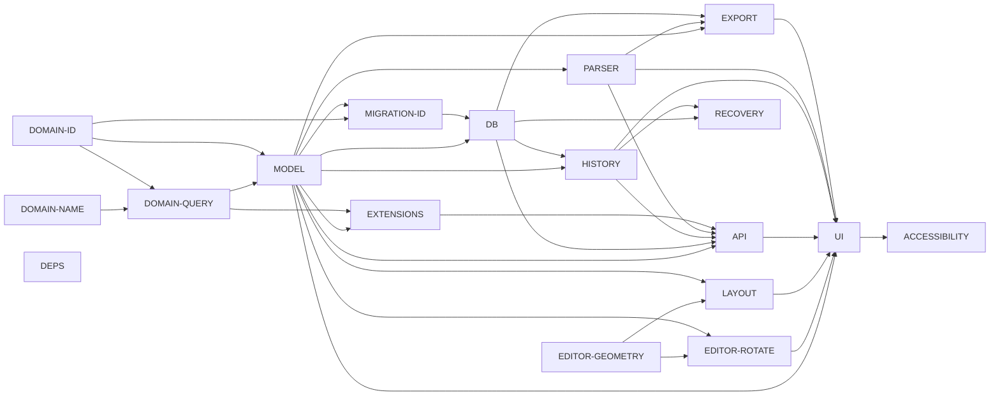

# SysON Rust execution plan (ACTIVE)

This plan governs continuous work toward all 18 permanent work areas in the pinned SysON baseline. The machine-readable [execution-backlog.json](execution-backlog.json) is authoritative for item state, dependencies, evidence, ownership and next work. The existing integration lane remains the single integrator; the existing source-map, frontend and independent-validation lanes remain the workers. This plan creates no additional writer, runtime entitlement or deployment authority.

The 18 IDs are unequal-sized work areas inherited from PARITY-LEDGER.json, not a complete or equal-sized feature denominator. Nine currently have bounded implementation and executed Rust evidence; zero are wholly completed and zero have full-area original-behavior parity. The strict seed ledger remains three behaviors, three Rust records, no upstream records and zero verified. Grammar 735 and AST 848 declaration obligations are separate inventories and must never be summed with areas, documentation headings or tests.

## Source, proposed work and proof

Pinned SysON source is `6ba2ac64e6b16ee2b05752ad55395eebb87d4910`. Sirius `3191e2b8990373afee3415f6b26f8c5039a28321` and Syside `1326f234cae23b0e4777d5a48a069b17e9e332f1` are candidate dependency source pins; resolved artifact/build/notice correspondence is not established by those revisions. The [area evidence map](source-map/execution-area-evidence.json) records 48 re-read/hash-checked source anchors, known behavior, exclusions and unclosed surfaces for every area. Source presence is a fact; a design or planned test is a proposal; only a recorded execution is runtime evidence.

Every area has its own baseline/component references, known contracts and exclusions, owner, potential writable boundary, implementation dependencies, buildable milestone item IDs, Rust/reference tests, integration and real-user acceptance, provenance/license gates, actual evidence, separate implementation/test/parity states, precise blockers and next ready item. Exclusions define boundaries or assignment to another area; they do not authorize dropping baseline behavior. Unknown inherited behavior stays visible.

The inventory must explicitly include inherited authentication, authorization, sessions, collaboration and event processing under API/HISTORY/DB; error/cancel/retry and interrupted operations under every affected area; deployment/runtime/upgrade/rollback under UI/API/DB/RECOVERY/DEPS; and all text/EMF/project/archive/diagram import/export behavior under PARSER/EXPORT/MODEL. The area inventories must map these contracts to stable subitems instead of silently treating them as external.

## Dependency DAG and acceptance gates

The following edges sequence implementation foundations. They are not final parity gates. Source inspection, isolated fixture preparation and qualified Rust kernels can proceed while full Java/application/reference or license closure is pending. In particular, domain/helper construction does not wait on the entire model merely because final effective-name semantics need model integration. Dependency recommendations in a source audit are not automatically imported as edges.

`DEPS` runs independently as a qualification work area. Its unresolved artifact/license/platform gates apply to final acceptance; adding a dependency on complete DEPS to every source task would falsely stop safe work. `items.depends_on` is the executable pull DAG: only satisfied DONE prerequisites permit READY/ACTIVE. Full-area dependencies never substitute for exact scoped item prerequisites.

## Current area accounting

| Permanent area | Implementation / Rust tests / parity | Lane | Next source item |
| --- | --- | --- | --- |
| DOMAIN-NAME | BOUNDED / BOUNDED / NO | source_map | DOMAIN-NAME-INVENTORY-01 |
| DOMAIN-ID | BOUNDED / BOUNDED / NO | source_map | DOMAIN-ID-INVENTORY-01 |
| DOMAIN-QUERY | BOUNDED / BOUNDED / NO | source_map | DOMAIN-QUERY-INVENTORY-01 |
| EDITOR-ROTATE | BOUNDED / BOUNDED / NO | frontend | EDITOR-ROTATE-INVENTORY-01 |
| EDITOR-GEOMETRY | BOUNDED / BOUNDED / NO | frontend | EDITOR-GEOMETRY-INVENTORY-01 |
| MIGRATION-ID | BOUNDED / BOUNDED / NO | root | MIGRATION-ID-INVENTORY-01 |
| MODEL | BOUNDED / BOUNDED / NO | frontend | MODEL-INVENTORY-01 |
| PARSER | BOUNDED / BOUNDED / NO | source_map | PARSER-INVENTORY-01 |
| UI | BOUNDED / BOUNDED / NO | frontend | UI-INVENTORY-01 |
| LAYOUT | NONE / NONE / NO | frontend | LAYOUT-INVENTORY-01 |
| API | NONE / NONE / NO | root | API-INVENTORY-01 |
| DB | NONE / NONE / NO | root | DB-INVENTORY-01 |
| RECOVERY | NONE / NONE / NO | root | RECOVERY-INVENTORY-01 |
| HISTORY | NONE / NONE / NO | root | HISTORY-INVENTORY-01 |
| ACCESSIBILITY | NONE / NONE / NO | frontend | ACCESSIBILITY-INVENTORY-01 |
| EXPORT | NONE / NONE / NO | root | EXPORT-INVENTORY-01 |
| EXTENSIONS | NONE / NONE / NO | source_map | EXTENSIONS-INVENTORY-01 |
| DEPS | NONE / NONE / NO | validation | DEPS-INVENTORY-01 |

The nine legacy unported/unresolved areas each have independent NONE implementation/test status, explicit source-inventory work and concrete qualification blockers. Existing local snapshot/history/import-export/tab behavior remains credited to its bounded MODEL/UI contract; it does not prove PostgreSQL, collaboration, all-format interchange, crash recovery or accessibility equivalence. MODEL/UI test pointers are reconciled to existing M7 evidence, without changing area status or manufacturing upstream parity.

## Ready-work and lease protocol

1. Keep the same integrator and isolated worker worktrees. Read the authoritative backlog and inspect live Git/worktree state before a new item. Preserve unrelated or dirty work. An item must name a concrete next action and canonical repository-relative file/directory boundaries.
2. Finish an ACTIVE milestone by committing only its scoped files and reporting source/commit hashes, actual test commands and UTC, full outputs/failures, limits and requested next READY item. Passing tests qualify only their actual scope. Do not rerun unchanged tests merely for a fresh timestamp.
3. A worker pulls a READY item assigned to its lane and requests its lease from the integrator, naming the item, base revision, exact paths and current dirty state. The integrator confirms prerequisites, authority and absence of conflicting held leases, records the grant and receives the worker's explicit acknowledgement. Then the worker starts. Root plan/integration bookkeeping and one bounded root implementation item can coexist under the same single writer; worker code ownership remains explicit.
4. Leases have no inactivity expiry. ACTIVE leases remain held even if work becomes BLOCKED. Only explicit release/transfer after preserving the exact work permits another writer. DONE items require released leases. Never infer release from an idle session, elapsed time or a stale inventory.
5. After a scoped buildable milestone, obtain distinct independent review, resolve findings, preserve the original failure and executed revisions, and integrate through focused cherry-picks. Preserve original executed source/harness revisions on audited evidence branches where necessary; do not relabel a run to a cherry-pick SHA. Update the draft PR with exact scope and remaining gates. No merge is authorized.
6. Pull the next READY authorized item after release. Prefer the current critical-path subitem, then independent source preparation or qualification that fits the same authority. Unimplemented umbrella items must be split into source-enumerated, reviewable API/file/test scopes before a code lease; their generic description is not permission to start a broad rewrite.
7. On BLOCKED, record exact action, target, reason and PENDING/DENIED/UNCERTAIN/UNAVAILABLE status, expected effects, existing authority and stop condition. A denied action is not retried through another host/path; uncertain outcomes are inspected before retry. A blocked writer either retains its lease or explicitly seals/preserves/releases it. Continue another independent READY item after a safe lease grant. Park briefly only when all eligible ready work is exhausted or gated, and leave exact resume instructions.

The integrator serializes backlog changes and validates them before publication. This avoids competing writers to the ownership record. The validator is a consistency rejection gate, not authentication of fabricated reports or proof of omitted source completeness.

## Active work and resource allocation

- `MODEL-RAW-FACTORY-01`: candidate `e075dd949` is committed with owner-reported checks. Its write/compiler leases are released. Independent review is pending; initializer/route/JSON semantics remain separate.
- `PARSER-REFLECTION-PREP-01`: completed source preparation `b0ffb69b2` is integrated as `94f36fc84`; static reproduction passed. The source lease is released. No reflection implementation or runtime parity is claimed.
- `PARSER-CORPUS-RUST-01`: bounded build/observations are captured and source lease explicitly released, BLOCKED on independent review. The twelve upstream captures and twelve native observations now exist; distinct independent reconciliation remains pending. Two diagnostic-route ASTs do not qualify all grammar rules; missing AST is not proof of no recovered parser AST.
- `PLAN-VALIDATE-01`: independent checker/tests and evidence are committed and integrated; final90 normal and90 optimized tests passed. The validator explicitly released its scope. The checker enforces IDs, dependency DAGs, held leases, status/evidence consistency and denominator history; it does not authenticate runtime claims or prove source completeness.
- `PLAN-INTEGRATE-01`: completed plan freeze `b4d017938` is published in draft PR1; this item is explicitly released. The same integrator continues serialized backlog maintenance.
- `MIGRATION-ID-INVENTORY-01`: source candidate is committed; root explicitly released its scope. Independent review is pending and full-area inventory remains incomplete.
- `MODEL-FACTORY-REVIEW-01`: the same validator passed its clean checkpoint and ACKed the exact source-only review/harness paths. Static source reads completed, but the validator remains held BLOCKED by the resource/context hold. It has not been awakened under the root-only allocation; no review artifact or independent regression run is claimed.

- `API-INVENTORY-01`: the same root integrator pulled source-only API contract inventory under its exact directory; implementation and inherited runtime closure remain separate.

The compilation cap is GLOBAL across projects: at most two one-job compiler processes, allocated by the parent coordinator. SysON currently has ZERO allocated Cargo/compiler slots and no compiler leases. Request one slot through the parent before any build; do not infer a grant from this plan or an earlier session. Source/Python validation continues without Cargo. Release capacity explicitly; parent owns monitoring and changes to allocation. Builds/caches/artifacts stay on the approved development volume; native HOME/CODEX state stays in place. Use one owned preview and isolated closed headless browser launches; no competing/shared GUI takeover.

## Evidence and completion

An item marked DONE is complete only for its named bounded scope. An area marked implemented COMPLETE needs its closed enumerated behavior inventory and accepted implementation subitems, including failures and unsupported outcomes. Rust-tested COMPLETE requires actual complete-scope executed tests, not a test plan or registry count. Parity YES additionally requires matched pinned upstream/reference and Rust cases, independent acceptance, integration and real-user evidence, source/artifact/license closure and no unresolved required blocker. Native unit tests, generated metadata, syntax recognition, hashes and screenshots cannot independently establish full application parity.

Evidence entries identify kind, exact committed path/revision, actual run/review status and scope. Planned PENDING/NOT_RUN entries cannot satisfy completion. Preserve exact raw versus transformed output hashes, command/environment, test source bytes, actual runtime UTC, author/committer UTC and capture intervals separately. Do not invent missing timestamps. Follow [M7](M7-CHECKPOINT.md), [M8 independent AST review](validation/M8-INDEPENDENT-REVIEW.md), existing strict behavior-ledger rules and the exact oracle decision.

Existing package/credential/entitlement, security/service-registration, paid API, production-state and unreviewed upstream build/runtime authority is not expanded by this plan. Current full Java/Maven/artifact/stdlib/application and dependency-notice gates remain action-specific. Preserve every existing service/storage/firmware hold. No SCP retry, bypass, broad updater or merge is authorized.

## Denominator and scope history

All18 original IDs remain permanent traceable anchors. Never delete/reuse/redefine an ID to improve a fraction. Discovered behavior appends stable subitems; splitting preserves the parent scope and maps every child. Retirement needs a recorded reason/evidence/acceptance and preserves history; it cannot conceal an unresolved original goal. Record any area-denominator change with an explicit ESTABLISH/APPEND/SPLIT/RETIRE event and reviewed validator/schema change. The initial schema deliberately rejects new event types until that extension is reviewed. Report old/new counts and why they changed. Never sum work areas, behavior fixtures, grammar declarations, AST obligations or documentation headings.

## Continuity and resume

This is an active running-session pull protocol, not a promise of unattended future wake-ups. The coordinator reported `isError=true: Automations are only supported for local threads.` No automation was created, and no workaround cron or competing writer is authorized. That scheduling limit does not block the current integrator/workers.

If sessions stop, resume the same integrator: read this file and execution-backlog.json, inspect live source/worktree/lease/evidence state, confirm held ownership explicitly, run the backlog consistency check, and pull the named next READY item. Do not start another top-level writer or infer release. Resume active leases before broader work; leave precise blockers and ready IDs if an external action is required. The backlog is durable even when a future wake-up is unavailable.

Staged resume preserves the interrupted drafts and initial checker failure. The generic historical application-permission error has unresolved actor/cause; it is not attributed to a human or treated as a permission grant. The integrator and validation lane each passed their own ordinary read-only checkpoint before scoped source work resumed. Current live leases and released completed scopes are recorded in the backlog; no other lane is restarted by this document.
